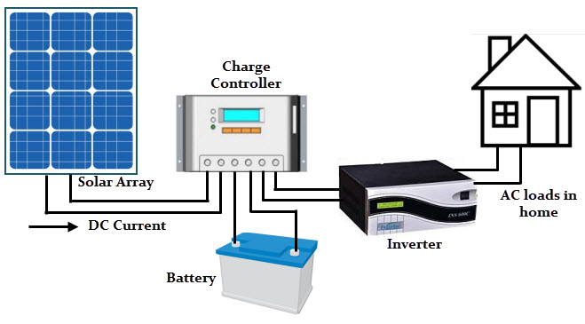

# Enhancing PV Grid Management Through AC-Power Prediction


## Project Descrption

- Solar energy generation is rapidly emerging as one of the most promising and fastest-growing renewable sources of power worldwide. With the increasing demand for electrical energy in our daily lives, photovoltaic (PV) cells have become a key player in meeting these needs. PV cells, semiconductor devices, directly convert sunlight energy into electricity through the photovoltaic effect.

- A single solar cell, measuring 4 cm2, produces a voltage of 0.5 to 1 V and can generate 0.7W of power when exposed to sunlight. The most efficiently designed solar panels typically achieve a maximum efficiency of 25%. To enhance voltage and power generation, individual cells are interconnected, with some connected in series and others in parallel.

<p align="center">
  
</p>

- PV modules are created by connecting numerous solar cells, and these modules are further linked to form a PV array suitable for applications ranging from small-scale to high-power generation. In a Solar Energy Generating System (SEGS) displayed above, solar panels convert solar energy into Direct Current (DC). This DC is then routed through an inverter to transform it into Alternating Current (AC), making it more compatible with transmission through centralized power grids.

> One of the challenges that needs to be solved is the unpredictability of solar power generation due to weather conditions, panel degradation, and maintenance needs. Grid operators struggle with integrating fluctuating solar energy into the power grid efficiently. There's a critical need for accurate AC-power prediction models that can forecast generation capacity days in advance, allowing for better load balancing and resource allocation. Additionally, the lack of accessible, standardized methods to identify when panels require cleaning or maintenance leads to unnecessary efficiency losses. This project aims to develop predictive models that address these gaps, helping plant operators and grid managers optimize solar energy integration while maximizing power output through timely maintenance interventions.

## Dataset Source

This data has been gathered at two solar power plants in India over a 34 day period. It has two pairs of files - each pair has one power generation dataset and one sensor readings dataset. The power generation datasets are gathered at the inverter level - each inverter has multiple lines of solar panels attached to it. The sensor data is gathered at a plant level - single array of sensors optimally placed at the plant.

Dataset Kaggle Link : https://www.kaggle.com/datasets/anikannal/solar-power-generation-data/data?select=Plant_2_Generation_Data.csv

## Goal

- Analyzing the potential AC-Power generated in next couple of days for better grid management.

- Identify the need for panel cleaning/maintenance through sensor and inverter data.

## Running the Project

### 1. Regenerate the models

Open `Prediction of AC-Power.ipynb` in Jupyter and run all cells, or execute the same code headlessly:

```powershell
.\.venv\Scripts\python.exe tests\verify_notebook.py
```

The notebook writes `models/gradientboosting_tuned.joblib`, `models/randomforest_tuned.joblib`, and
`models/manifest.json`. The manifest is authoritative: the app reads it, so a re-run that changes the winning
models does not require editing app code.

### 2. Launch the Studio

```powershell
.\.venv\Scripts\python.exe -m streamlit run main.py
```

The app refuses to start if the manifest is missing or a bundle does not match the manifest's feature list.
Regenerate the models first. Tabs: **Predict** (one plant/hour with median-condition prefill), **Batch** (score a
CSV), **Insights** (metrics, per-plant error, drivers), **About** (model card and limitations).

### 3. Run the tests

```powershell
.\.venv\Scripts\python.exe -m unittest discover -s tests -v
```

`tests/verify_notebook.py` executes the notebook's code cells in one process, so no `nbformat`/`nbclient`
dependency is needed.

## Project Structure

```
Prediction of AC-Power.ipynb   six-stage analysis; writes models/
main.py                        Streamlit entry point
ac_power/                      app package (config, schema, data, analytics, ui, views)
utils/                         vendored ML toolkit
data/                          generation and weather CSVs, batch example
models/                        generated bundles and manifest.json
tests/                         unittest suite and notebook verifier
docs/utils-bug-report.md       defects found in the vendored toolkit
```